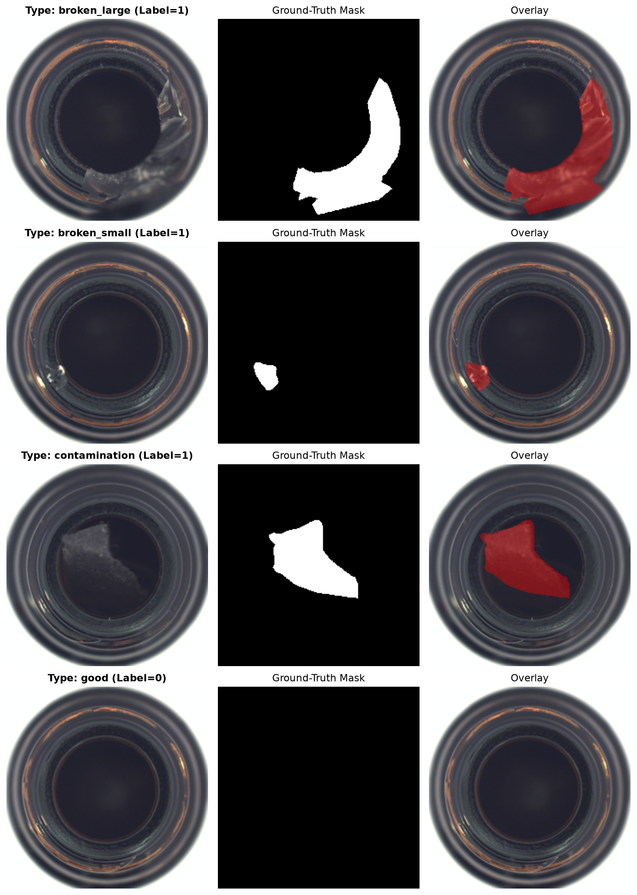
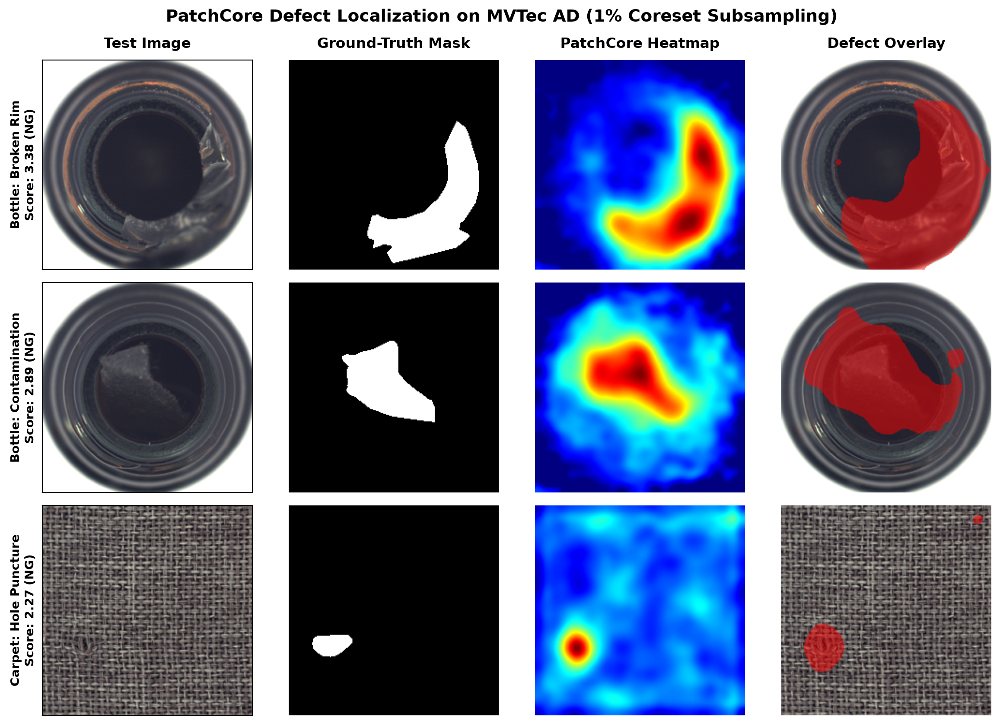

<div align="center">

# ANOMALY-VISION

### Deep Learning-Based Industrial Visual Anomaly Detection

<p>
  
  
  
  
  
  
</p>

<p align="center">
  A modular framework for unsupervised defect detection and pixel-level anomaly localization on the MVTec AD benchmark.
</p>

</div>

<hr />

## Project Overview

In industrial manufacturing, anomalies such as cracks, scratches, structural deformations, and contaminations occur rarely. Standard supervised classifiers fail due to severe class imbalance and the unbounded variety of potential defects.

**ANOMALY-VISION** addresses this cold-start quality inspection problem via **One-Class Visual Representation Learning**:
- Training is conducted strictly on defect-free samples (normal data).
- The model establishes a distribution of normality.
- At test time, deviations from this distribution are detected, scored, and localized down to individual pixels.

<div style="background-color: #f6f8fa; border-left: 4px solid #0969da; padding: 12px 16px; margin: 16px 0; border-radius: 4px;">
  <strong>Current Progress:</strong> Phases 1, 2, 3, and 4 are Complete across 3 distinct MVTec AD categories (<em>bottle</em>, <em>capsule</em>, <em>carpet</em>):
  <br />- <strong>ConvAE Baseline:</strong> 93.3% AUROC on <em>bottle</em>, but collapses to 64.5% on <em>capsule</em> (Generalization Paradox).
  <br />- <strong>PatchCore-ResNet18 (Coreset 1%, 2.4 MB):</strong> Image-AUROC <strong>100.0%</strong> on <em>bottle</em>, <strong>93.8%</strong> on <em>capsule</em> (+29.3% recovery over AE), <strong>97.3%</strong> on <em>carpet</em>.
  <br />- <strong>PatchCore-ViT-Base (Coreset 1%, 3.6 MB):</strong> Image-AUROC <strong>97.9%</strong> on <em>bottle</em>, <strong>83.1%</strong> on <em>capsule</em>, <strong>95.3%</strong> on <em>carpet</em> with 410 patches.
  <br />- <strong>kNN-ViT-Base (Full Bank):</strong> Image-AUROC <strong>100.0%</strong>, Pixel-AUROC <strong>98.2%</strong> on <em>bottle</em>.
</div>

---

## Technical Pipeline

```text
Normal Training Images
         |
         v
Deep Feature Representation (CNN / ViT / Autoencoder)
         |
         v
Normality Modeling (Latent Reconstruction / Patch Memory Bank)
         |
         v
Inference Image
         |
         +---> 1. Image-Level Anomaly Score (Normal vs. Defect)
         |
         +---> 2. Pixel-Level Heatmap (Defect Localization)
```

---

## Implementation Roadmap

<table>
  <thead>
    <tr>
      <th>Stage</th>
      <th>Method</th>
      <th>Core Mechanism</th>
      <th>Key Metrics</th>
      <th>Status</th>
    </tr>
  </thead>
  <tbody>
    <tr>
      <td><b>Phase 1</b></td>
      <td>Dataset & Preprocessing</td>
      <td>Modular PyTorch DataLoader, Nearest-neighbor mask interpolation, Multi-category EDA</td>
      <td>Data integrity</td>
      <td><b>Completed</b></td>
    </tr>
    <tr>
      <td><b>Phase 2</b></td>
      <td>Reconstruction Baseline</td>
      <td>ConvAutoencoder & ConvVAE with L1 + SSIM loss, KL divergence, and training resume</td>
      <td>Reconstruction Error, Image-AUROC</td>
      <td><b>Complete</b> (AE: 93.3% / VAE: 89.1% Image-AUROC on <em>bottle</em>)</td>
    </tr>
    <tr>
      <td><b>Phase 3</b></td>
      <td>Feature Embedding & ViT Deep Dive</td>
      <td>ResNet & ViT feature extractors, Multi-Head Self-Attention hooks, Memory Bank k-NN scoring</td>
      <td>Image-AUROC, Pixel-AUROC, PRO</td>
      <td><b>Complete</b> (kNN-ViT-Base: 100.0% Image-AUROC, 98.2% Pixel-AUROC; kNN-ResNet18: 99.6% Image-AUROC on <em>bottle</em>)</td>
    </tr>
    <tr>
      <td><b>Phase 4</b></td>
      <td>PatchCore (SOTA)</td>
      <td>Patch features, 3x3 Neighborhood Pooling, Greedy Farthest-Point Coreset Subsampling (ResNet & ViT backbones)</td>
      <td>Image-AUROC, Pixel-AUROC, PRO</td>
      <td><b>Complete</b> (100.0% on <em>bottle</em>, 97.3% on <em>carpet</em>, 93.8% on <em>capsule</em> with 1% Coreset)</td>
    </tr>
    <tr>
      <td><b>Phase 5</b></td>
      <td>Localization & Metrics</td>
      <td>Gaussian-smoothed anomaly heatmaps, Per-Region Overlap (PRO) across categories</td>
      <td>PRO Metric</td>
      <td><b>Complete</b> (bottle PRO: 91.3%, carpet PRO: 93.5%)</td>
    </tr>
    <tr>
      <td><b>Phase 6</b></td>
      <td>Deployment Demo</td>
      <td>Interactive web interface with Gradio for real-time inference</td>
      <td>Inference Latency</td>
      <td><b>Complete</b> (Gradio interactive UI)</td>
    </tr>
  </tbody>
</table>

---

## Core Formulations & Methodologies

### 1. Reconstruction Baselines (Autoencoder & VAE)

#### Anomaly Residual Map

$$\text{Map}(u, v) = \frac{1}{C} \sum_{c=1}^C |x_c(u, v) - \hat{x}_c(u, v)|$$

- $x$: Original input image normalized to $[0.0, 1.0]$.
- $\hat{x}$: Reconstructed image produced by the decoder.
- $C$: Number of channels ($C=3$).

#### Composite Reconstruction Loss (L1 + SSIM)

$$\mathcal{L}_{\text{recon}} = \alpha \mathcal{L}_1(x, \hat{x}) + (1 - \alpha)(1 - \text{SSIM}(x, \hat{x}))$$

- $\alpha = 0.85$: Balances pixel-wise absolute error ($\mathcal{L}_1$) with structural similarity.
- $\text{SSIM}$: Evaluates localized luminance, contrast, and structural correlation over 11x11 2D Gaussian kernels to prevent blurred edges.

#### Variational Objective (VAE)

$$\mathcal{L}_{\text{VAE}} = \mathcal{L}_{\text{recon}} + \beta \cdot D_{\text{KL}}(q_\phi(z|x) \parallel p(z))$$

$$D_{\text{KL}} = -\frac{1}{2} \sum_{j=1}^d \left(1 + \log \sigma_j^2 - \mu_j^2 - \sigma_j^2\right)$$

- $\mu, \sigma^2$: Mean and variance predicted by the encoder for latent dimension $d=128$.
- Reparameterization during training: $z = \mu + \epsilon \odot \sigma$ with $\epsilon \sim \mathcal{N}(0, I)$. Evaluated deterministically at test time via $z = \mu$.
- $\beta = 0.0001$: Weight of the Kullback-Leibler divergence regularizer.

#### Image-Level Anomaly Score (Reconstruction)

$$S_{\text{image}} = \frac{1}{|K|} \sum_{(u, v) \in K} \text{Map}(u, v)$$

- $K$: Set of spatial coordinates corresponding to the top 5% highest residual error pixels, preventing normal background pixels from diluting localized defect signals.

---

### 2. Deep Feature Embedding & k-NN Memory Bank

#### Multi-Scale Intermediate Feature Alignment

$$f(p) = \left[ f_{\text{layer2}}(p) \;\parallel\; \text{Upsample}(f_{\text{layer3}}(p)) \right] \in \mathbb{R}^D$$

- $f_{\text{layer2}}(p) \in \mathbb{R}^{128}$: Intermediate activations captured via PyTorch forward hooks from ResNet-18 `layer2` (spatial grid 28x28 for 224x224 input).
- $f_{\text{layer3}}(p) \in \mathbb{R}^{256}$: Activations from `layer3` (14x14 grid), bilinearly upsampled to 28x28 to align spatial resolution.
- $D = 128 + 256 = 384$: Fused feature embedding dimension for each of the $P = 28 \times 28 = 784$ spatial patches.

#### Patch Anomaly Scoring via k-NN Euclidean Distance

$$s(p) = \frac{1}{k} \sum_{j=1}^k \|f(p) - m_{(j)}\|_2$$

- $f(p) \in \mathbb{R}^{384}$: Query patch embedding of the test image at coordinate $p$.
- $m_{(j)} \in \mathcal{M}$: The $j$-th nearest neighbor vector within the normal training Memory Bank $\mathcal{M}$ ($N_{\text{bank}} = 163,856$ vectors for *bottle*).
- $\|\cdot\|_2$: Euclidean distance ($L_2$ norm) in the unconstrained 384-dimensional feature space.
- $k$: Number of nearest neighbors averaged (default: $k=1$ or $k=3$).

#### Image-Level Anomaly Score (Feature-Based)

$$S_{\text{image}} = \max_{p \in \{1, \dots, P\}} s(p)$$

- The image anomaly score is defined as the maximum patch distance across the entire image.

#### Pixel-Level Anomaly Heatmap (Bilinear Upsample + Gaussian Spatial Smoothing)

$$\mathcal{A}(u, v) = \left( s_{\text{upsampled}} \ast G_\sigma \right)(u, v) = \sum_{u', v'} s_{\text{upsampled}}(u', v') \cdot \frac{1}{2\pi\sigma^2} \exp\left(-\frac{(u - u')^2 + (v - v')^2}{2\sigma^2}\right)$$

- $s_{\text{upsampled}}$: Patch score map $s(p)$ bilinearly interpolated from $28 \times 28$ to full resolution $224 \times 224$.
- $G_\sigma$: 2D Gaussian filter kernel.
- $\sigma = 4.0$: Standard deviation of the Gaussian filter. Eliminates discrete patch boundary grid artifacts while preserving true defect boundaries.

---

### 3. Vision Transformer (ViT) Deep Feature Representation

#### Patch Tokenization and All-to-All Self-Attention
Unlike CNNs bounded by local receptive fields, Vision Transformers (Dosovitskiy et al., 2020) model global image context from Layer 1:
1. An input image $x \in \mathbb{R}^{3 \times 224 \times 224}$ is split into $N = 14 \times 14 = 196$ non-overlapping patches of size $16 \times 16$.
2. Patches are linearly projected to dimension $D = 768$ and prepended with a learnable `[CLS]` token $x_{\text{class}}$ plus 1D learnable position encodings.
3. Multi-Head Self-Attention (MSA) computes all-to-all patch affinities:

$$\text{Attention}(Q, K, V) = \text{softmax}\left(\frac{Q K^T}{\sqrt{d_k}}\right) V$$

#### Reshaping Tokens to 2D Spatial Grids
To integrate ViT representations into memory banks and PatchCore, `ViTExtractor`:
1. Drops the global `[CLS]` token at index 0.
2. Reshapes the remaining 196 patch tokens from sequence format $(B, 196, 768)$ into spatial grid $(B, 14, 14, 768)$.
3. Permutes to standard PyTorch tensor format: $(B, 768, 14, 14)$.
4. Hooks multiple intermediate transformer blocks (e.g. blocks 6, 9, 11) and concatenates channels to form a rich multi-scale representation of dimension $D = 2304$.

---

### 4. PatchCore: SOTA Memory Bank & Coreset Subsampling

#### Multi-Scale Patch Representation with Neighborhood Context

To capture spatial context and build invariance against minor spatial translations, multi-scale feature maps from `layer2` and `layer3` are aggregated locally using $K \times K$ average pooling ($K=3$, padding 1, stride 1):

$$p(u, v) = \frac{1}{K^2} \sum_{i=-\lfloor K/2 \rfloor}^{\lfloor K/2 \rfloor} \sum_{j=-\lfloor K/2 \rfloor}^{\lfloor K/2 \rfloor} F(u+i, v+j) \in \mathbb{R}^{384}$$

- $F(u, v) = [f_{\text{layer2}}(u, v) \parallel \text{Upsample}(f_{\text{layer3}}(u, v))] \in \mathbb{R}^{384}$.
- Aggregating across all normal training images yields the full memory bank $\mathcal{M}$.

#### Minimax Facility Location Coreset Subsampling

To eliminate memory overhead and accelerate inference, a subset $\mathcal{M}_C \subset \mathcal{M}$ of fraction $\gamma = 0.01$ (1%) is constructed to minimize the maximum distance from any nominal patch in $\mathcal{M}$ to its nearest coreset point:

$$\mathcal{M}_C^* = \arg\min_{\mathcal{M}_C \subset \mathcal{M}} \max_{m \in \mathcal{M}} \min_{c \in \mathcal{M}_C} \|m - c\|_2$$

- **Greedy Farthest-Point Iteration:** Initialized with $c_1 \sim \mathcal{M}$, iteratively selecting:

$$c_t = \arg\max_{m \in \mathcal{M}} \min_{c \in \mathcal{M}_C} \|m - c\|_2$$

- **Distance Caching:** Maintains a running minimum distance vector across iterations with $O(|\mathcal{M}|)$ update complexity per step.
- **Johnson-Lindenstrauss Random Projection:** Vectors are projected to $d=128$ dimensions via $R \sim \mathcal{N}(0, 1/d)$ during coreset search, preserving Euclidean distances while reducing selection time to ~3 seconds.

#### Softmax Neighborhood Density Re-weighting

For query image $x_{\text{test}}$, let $p^* = \arg\max_p s(p)$ denote the maximally anomalous patch with distance $s^* = s(p^*)$, and let $\mathcal{N}_b(p^*) \subset \mathcal{M}_C$ be its $b=9$ nearest coreset neighbors:

$$w = 1 - \frac{\exp(s^* / T)}{\sum_{c \in \mathcal{N}_b(p^*)} \exp(\|p^* - c\|_2 / T)} = 1 - \frac{1}{\sum_{c \in \mathcal{N}_b(p^*)} \exp\left((s^* - \|p^* - c\|_2) / T\right)}$$

$$S_{\text{image}} = w \cdot s^*$$

- $T = \max(1.0, D / 384)$: Dimensionality-aware temperature scaling preventing exponential saturation in high-dimensional feature spaces (e.g. ViT 2304-D).
- In dense nominal regions, large neighbor sums drive $w \to 1.0$.
- In sparse boundary regions of normal variation, small neighbor sums scale $w \to 0.0$, suppressing boundary false alarms.

---

## Quantitative Benchmarks (MVTec AD)

Evaluated on official MVTec AD test sets across rigid objects (`bottle`, `capsule`) and textured surface (`carpet`) categories:

| Category | Type | Model Architecture | Image AUROC | Pixel AUROC | PRO Score (FPR <= 0.3) | Memory Bank Size | Latency (GPU) |
|---|---|---|---|---|---|---|---|
| **bottle** | Object | Convolutional Autoencoder (AE) | 93.33% | 82.74% | 59.18% | N/A (Recon) | ~5 ms / image |
| **bottle** | Object | Convolutional VAE (VAE) | 89.13% | 80.12% | 51.48% | N/A (Recon) | ~5 ms / image |
| **bottle** | Object | kNN-ResNet18 (Full Bank 100%) | 99.60% | 97.62% | 93.80% | 163,856 patches (240.0 MB) | 162 ms / image |
| **bottle** | Object | kNN-ViT-Base (Full Bank 100%) | **100.00%** | **98.24%** | 89.74% | 40,964 patches (377.5 MB) | 210 ms / image |
| **bottle** | Object | **PatchCore-ResNet18 (Coreset 1%)** | **100.00%** | 97.69% | **91.31%** | **1,639 patches (2.4 MB)** | **82 ms / image** |
| **bottle** | Object | PatchCore-ViT-Base (Coreset 1%) | 97.94% | 96.68% | 79.45% | **410 patches (3.6 MB)** | 86 ms / image |
| **capsule** | Object | Convolutional Autoencoder (AE) | 64.50% | 86.59% | 66.67% | N/A (Generalization Paradox) | ~5 ms / image |
| **capsule** | Object | **PatchCore-ResNet18 (Coreset 1%)** | **93.82%** | **98.39%** | **88.59%** | **1,717 patches (2.5 MB)** | **122 ms / image** |
| **capsule** | Object | PatchCore-ViT-Base (Coreset 1%) | 83.05% | 95.44% | 77.69% | **430 patches (3.8 MB)** | 123 ms / image |
| **carpet** | Texture | **PatchCore-ResNet18 (Coreset 1%)** | **97.27%** | **98.65%** | **93.47%** | **2,196 patches (3.3 MB)** | **121 ms / image** |
| **carpet** | Texture | PatchCore-ViT-Base (Coreset 1%) | 95.26% | 97.93% | 87.81% | **549 patches (4.8 MB)** | 120 ms / image |

---

## Qualitative Visualizations

### 1. MVTec AD Defect Exploration
Representative defect types and ground-truth localization masks across dataset categories:



### 2. PatchCore Defect Localization (1% Coreset Subsampling)
Pixel-level defect localization and overlay masks generated by PatchCore on object (`bottle`) and texture (`carpet`) anomalies:



---

## Directory Structure

```text
Anomaly Detection/
|-- app/
|   `-- demo.py                     # Interactive Gradio web inspection demo
|-- assets/                         # Documentation materials & README figures
|   |-- eda_gallery.png             # Dataset exploration gallery
|   `-- patchcore_localization_summary.png # Qualitative localization summary
|-- configs/
|   `-- config.yaml                 # Central experiment configurations
|-- data/                           # MVTec AD dataset directory (15 categories)
|   |-- bottle/
|   |-- capsule/
|   `-- carpet/
|-- checkpoints/                    # Saved model weights & memory bank artifacts
|   |-- bottle_ae/best.pth          # ConvAutoencoder checkpoint
|   |-- capsule_ae/best.pth         # ConvAutoencoder checkpoint (capsule)
|   `-- patchcore/                  # PatchCore coreset memory banks (.pt)
|       |-- bottle_resnet18_c0.01.pt
|       |-- capsule_resnet18_c0.01.pt
|       |-- carpet_resnet18_c0.01.pt
|       |-- bottle_vit_base_patch16_224_c0.01.pt
|       |-- capsule_vit_base_patch16_224_c0.01.pt
|       `-- carpet_vit_base_patch16_224_c0.01.pt
|-- notebooks/                      # Comprehensive analysis & educational walkthroughs
|   |-- 01_dataset_exploration.ipynb# EDA, defect distributions, mask stats
|   |-- 02_autoencoder_baseline.ipynb# AE & VAE reconstruction error analysis
|   |-- 03_feature_extraction.ipynb # ResNet intermediate features & k-NN manifold
|   |-- 04_vit_features.ipynb       # ViT Multi-Head Self-Attention & DINO saliency
|   `-- 05_patchcore.ipynb          # SOTA PatchCore coreset analysis & multi-backbone
|-- results/                        # Benchmark metrics, figures, and localization plots
|   |-- bottle_baseline_benchmark.csv
|   |-- capsule_baseline_benchmark.csv
|   |-- feature_knn/
|   `-- patchcore/
|-- scripts/
|   |-- train_autoencoder.py        # AE & VAE training with resume, tqdm, & TensorBoard
|   |-- evaluate_autoencoder.py     # AE & VAE evaluation suite (AUROC & PRO)
|   |-- build_feature_bank.py       # Offline feature memory bank builder
|   |-- evaluate_feature_knn.py     # k-NN anomaly evaluation & heatmap export
|   `-- run_patchcore.py            # End-to-end PatchCore training, coreset & benchmark
|-- src/
|   |-- data/
|   |   |-- mvtec.py                # Dataset loaders and statistical aggregators
|   |   `-- transforms.py           # Standardized image & mask transformations
|   |-- models/
|   |   |-- autoencoder.py          # ConvAutoencoder and ConvVAE classes
|   |   |-- coreset.py              # Greedy Farthest-Point Coreset Sampler
|   |   |-- feature_extractor.py    # ResNetExtractor, ViTExtractor, FeatureMemoryBank
|   |   |-- patchcore.py            # Multi-backbone PatchCore implementation (CNN & ViT)
|   |   `-- losses.py               # SSIMLoss, AutoencoderLoss, VAELoss
|   `-- utils/
|       |-- metrics.py              # AUROC, Pixel AUROC, and PRO score computation
|       `-- visualization.py        # Mask overlays, heatmaps, and defect galleries
|-- tests/                          # Automated Pytest suite (46 passing unit tests)
|   |-- data/
|   |-- models/
|   `-- utils/
|-- pytest.ini                      # Optimized test discovery configuration
|-- requirements.txt                # Python package dependencies
`-- README.md                       # Main project documentation
```

---

## Getting Started

### 1. Environment Setup

```bash
# Create and activate virtual environment
python -m venv .env
.\.env\Scripts\Activate.ps1

# Install package dependencies
pip install -r requirements.txt
```

### 2. Run Automated Test Suite (46 Tests)

```bash
# Run full unit and integration test suite across all modules
python -m pytest tests/ -v
```

### 3. Reconstruction Baseline Pipeline (AE & VAE)

```bash
# Train Autoencoder on bottle
python scripts/train_autoencoder.py --model ae --category bottle --epochs 50 --batch_size 16 --lr 1e-3

# Train Autoencoder on capsule
python scripts/train_autoencoder.py --model ae --category capsule --epochs 50 --batch_size 16 --lr 1e-3

# Evaluate trained Autoencoder
python scripts/evaluate_autoencoder.py --category bottle --model ae
```

### 4. Deep Feature Extraction & k-NN Memory Bank Pipeline

```bash
# Step 1: Extract normal features and serialize memory bank
python scripts/build_feature_bank.py --category bottle --backbone resnet18 --batch_size 16

# Step 2: Run k-NN evaluation and generate localization plots
python scripts/evaluate_feature_knn.py --category bottle --backbone resnet18 --n_neighbors 3
```

### 5. SOTA PatchCore Pipeline (1% Coreset Subsampling)

```bash
# Run PatchCore on 'bottle' with ResNet-18 (1% Coreset)
python scripts/run_patchcore.py --category bottle --backbone resnet18 --coreset_ratio 0.01

# Run PatchCore on 'bottle' with Vision Transformer (ViT-Base, 1% Coreset)
python scripts/run_patchcore.py --category bottle --backbone vit_base_patch16_224 --coreset_ratio 0.01

# Run PatchCore on 'capsule' (Definitively resolving the Generalization Paradox: 93.8% AUROC)
python scripts/run_patchcore.py --category capsule --backbone resnet18 --coreset_ratio 0.01

# Run PatchCore on 'carpet' (Textured Surface)
python scripts/run_patchcore.py --category carpet --backbone resnet18 --coreset_ratio 0.01
```

---

## References

- Bergmann, P., et al. (2019). *MVTec AD — A Comprehensive Real-World Dataset for Unsupervised Anomaly Detection*. CVPR 2019.
- Kingma, D. P., & Welling, M. (2013). *Auto-Encoding Variational Bayes*. arXiv:1312.6114.
- Wang, Z., et al. (2004). *Image Quality Assessment: From Error Visibility to Structural Similarity (SSIM)*. IEEE TIP.
- Roth, K., et al. (2022). *Towards Total Recall in Industrial Anomaly Detection (PatchCore)*. CVPR 2022.
