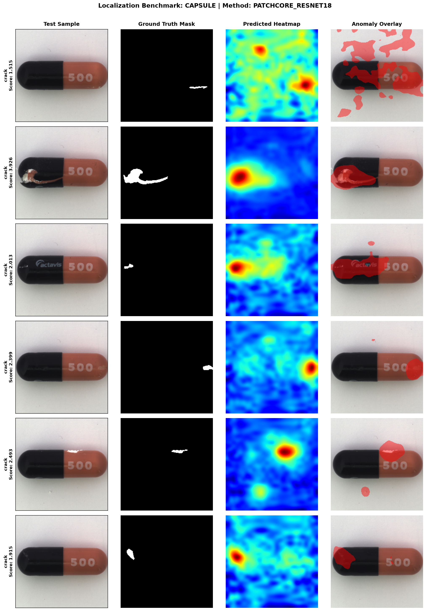
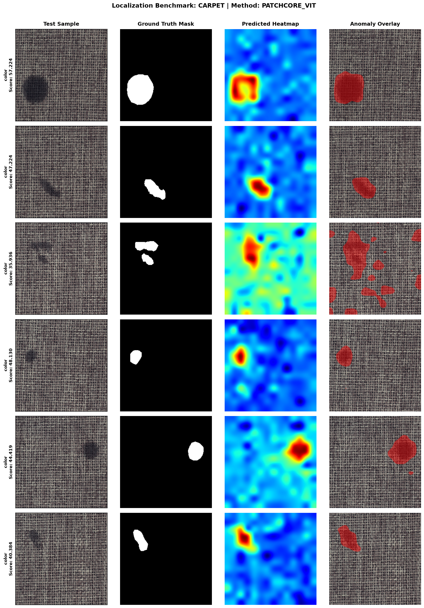

<div align="center">

# ANOMALY-VISION

### Deep Learning-Based Industrial Visual Anomaly Detection & Defect Localization

<p>
  
  
  
  
  
</p>

<p>
  
  
  
  
  
</p>

<p>
  
  
  
  
  
</p>

<p align="center">
  A modular framework for unsupervised defect detection and pixel-level anomaly localization on the MVTec AD benchmark.
</p>

</div>

<hr />

## Project Overview

In industrial manufacturing, anomalies such as cracks, scratches, structural deformations, and contaminations occur rarely. Standard supervised classifiers fail due to severe class imbalance and the unbounded variety of potential defects.

**ANOMALY-VISION** addresses this cold-start quality inspection problem via **One-Class Visual Representation Learning**:
- **Defect-Free Normal Training:** Models establish a robust manifold of normality strictly using nominal images.
- **Out-of-Distribution Scoring:** At test time, deviations from this nominal manifold are detected, scored, and localized down to individual pixels.
- **Benchmark Scale:** Evaluated across all 15 categories (5 textures, 10 rigid objects) of the comprehensive MVTec Anomaly Detection benchmark.

<div style="background-color: #f6f8fa; border: 1px solid #d0d7de; border-left: 5px solid #0969da; border-radius: 6px; padding: 14px 18px; margin: 16px 0;">
  <strong style="font-size: 14px; color: #0969da;">Core AI & Computer Vision Stack:</strong>
  <br />
  - <strong>Deep Learning & Acceleration:</strong> <code>PyTorch 2.0+</code>, <code>Torchvision</code> (CUDA GPU-accelerated tensor computations & forward hooks)
  <br />
  - <strong>Pretrained Backbones:</strong> <code>timm</code> (PyTorch Image Models, Vision Transformer token extraction)
  <br />
  - <strong>Computer Vision & Augmentation:</strong> <code>OpenCV (cv2)</code>, <code>Pillow (PIL)</code>, <code>Albumentations</code> (BICUBIC transforms, Gaussian filtering, contour extraction)
  <br />
  - <strong>High-Dimensional Vector Search:</strong> <code>FAISS</code>, <code>scipy.spatial</code> (Fast Euclidean k-NN patch memory retrieval)
  <br />
  - <strong>Evaluation Metrics:</strong> <code>scikit-learn</code> (Image/Pixel AUROC, Per-Region Overlap PRO, Youden's J & F1 optimal thresholding)
  <br />
  - <strong>Industrial GUI Deployment:</strong> <code>PyQt6</code> (Native Automated Optical Inspection AOI Workstation) & <code>Gradio</code> (Web demo)
</div>

<div style="background-color: #f6f8fa; border: 1px solid #d0d7de; border-left: 5px solid #1a7f37; border-radius: 6px; padding: 14px 18px; margin: 16px 0;">
  <strong style="font-size: 14px; color: #1a7f37;">Evaluated Model Paradigms & Baselines:</strong>
  <br />
  - <strong>Pixel Reconstruction Baseline:</strong> <code>ConvAutoencoder (AE)</code> &mdash; Bottleneck compression trained with composite $\mathcal{L}_1 + \text{SSIM}$ perceptual loss.
  <br />
  - <strong>Probabilistic Generative Baseline:</strong> <code>ConvVAE</code> &mdash; Latent Gaussian bottleneck regularized via Kullback-Leibler (KL) divergence.
  <br />
  - <strong>Deep Feature Memory Bank:</strong> <code>kNN-ResNet18</code> &mdash; Non-parametric anomaly detection using intermediate activations from convolutional layers (<code>layer2</code>, <code>layer3</code>).
  <br />
  - <strong>SOTA Memory Bank:</strong> <code>PatchCore-ResNet18</code> &mdash; Patch-level neighborhood aggregation with 1% Greedy Farthest-Point Coreset Subsampling (100x compression).
  <br />
  - <strong>Global Attention Transformer:</strong> <code>PatchCore-ViT-Base</code> &mdash; All-to-all Multi-Head Self-Attention feature hooks with dimensionality-aware temperature scaling.
</div>

<div style="background-color: #f6f8fa; border: 1px solid #d0d7de; border-left: 5px solid #8250df; border-radius: 6px; padding: 14px 18px; margin: 16px 0;">
  <strong style="font-size: 14px; color: #8250df;">Benchmark Scope & Protocol:</strong>
  <br />
  - <strong>Dataset:</strong> Official <code>MVTec Anomaly Detection (MVTec AD)</code> benchmark covering all 15 industrial categories (5 textures, 10 rigid objects).
  <br />
  - <strong>Protocol:</strong> Strictly unsupervised / one-class representation learning using exclusively nominal (defect-free) samples for training.
  <br />
  - <strong>Evaluation Metrics:</strong> Image-level AUROC (detection), Pixel-level AUROC (segmentation), and Per-Region Overlap (PRO score at FPR &le; 0.3).
  <br />
  - <strong>Production Performance:</strong> Real-time inference latency (~50 ms/image on CUDA) with automated conveyor belt inspection simulation.
</div>

---

## Core Formulations & Methodologies

### 1. Reconstruction Baselines (Autoencoder & VAE)

#### Anomaly Residual Map

$$\text{Map}(u, v) = \frac{1}{C} \sum_{c=1}^C |x_c(u, v) - \hat{x}_c(u, v)|$$

- $x$: Original input image normalized to $[0.0, 1.0]$.
- $\hat{x}$: Reconstructed image produced by the decoder.
- $C$: Number of channels ($C=3$).

#### Composite Reconstruction Loss (L1 + SSIM)

$$\mathcal{L}_{\text{recon}} = \alpha \mathcal{L}_1(x, \hat{x}) + (1 - \alpha)(1 - \text{SSIM}(x, \hat{x}))$$

- $\alpha = 0.85$: Balances pixel-wise absolute error ($\mathcal{L}_1$) with structural similarity.
- $\text{SSIM}$: Evaluates localized luminance, contrast, and structural correlation over 11x11 2D Gaussian kernels to prevent blurred edges.

#### Variational Objective (VAE)

$$\mathcal{L}_{\text{VAE}} = \mathcal{L}_{\text{recon}} + \beta \cdot D_{\text{KL}}(q_\phi(z|x) \parallel p(z))$$

$$D_{\text{KL}} = -\frac{1}{2} \sum_{j=1}^d \left(1 + \log \sigma_j^2 - \mu_j^2 - \sigma_j^2\right)$$

- $\mu, \sigma^2$: Mean and variance predicted by the encoder for latent dimension $d=128$.
- Reparameterization during training: $z = \mu + \epsilon \odot \sigma$ with $\epsilon \sim \mathcal{N}(0, I)$. Evaluated deterministically at test time via $z = \mu$.
- $\beta = 0.0001$: Weight of the Kullback-Leibler divergence regularizer.

#### Image-Level Anomaly Score (Reconstruction)

$$S_{\text{image}} = \frac{1}{|K|} \sum_{(u, v) \in K} \text{Map}(u, v)$$

- $K$: Set of spatial coordinates corresponding to the top 5% highest residual error pixels, preventing normal background pixels from diluting localized defect signals.

---

### 2. Deep Feature Embedding & k-NN Memory Bank

#### Multi-Scale Intermediate Feature Alignment

$$f(p) = \left[ f_{\text{layer2}}(p) \;\parallel\; \text{Upsample}(f_{\text{layer3}}(p)) \right] \in \mathbb{R}^D$$

- $f_{\text{layer2}}(p) \in \mathbb{R}^{128}$: Intermediate activations captured via PyTorch forward hooks from ResNet-18 `layer2` (spatial grid 28x28 for 224x224 input).
- $f_{\text{layer3}}(p) \in \mathbb{R}^{256}$: Activations from `layer3` (14x14 grid), bilinearly upsampled to 28x28 to align spatial resolution.
- $D = 128 + 256 = 384$: Fused feature embedding dimension for each of the $P = 28 \times 28 = 784$ spatial patches.

#### Patch Anomaly Scoring via k-NN Euclidean Distance

$$s(p) = \frac{1}{k} \sum_{j=1}^k \|f(p) - m_{(j)}\|_2$$

- $f(p) \in \mathbb{R}^{384}$: Query patch embedding of the test image at coordinate $p$.
- $m_{(j)} \in \mathcal{M}$: The $j$-th nearest neighbor vector within the normal training Memory Bank $\mathcal{M}$ ($N_{\text{bank}} = 163,856$ vectors for *bottle*).
- $\|\cdot\|_2$: Euclidean distance ($L_2$ norm) in the unconstrained 384-dimensional feature space.
- $k$: Number of nearest neighbors averaged (default: $k=1$ or $k=3$).

#### Image-Level Anomaly Score (Feature-Based)

$$S_{\text{image}} = \max_{p \in \{1, \dots, P\}} s(p)$$

- The image anomaly score is defined as the maximum patch distance across the entire image.

#### Pixel-Level Anomaly Heatmap (Bilinear Upsample + Gaussian Spatial Smoothing)

$$\mathcal{A}(u, v) = \left( s_{\text{upsampled}} \ast G_\sigma \right)(u, v) = \sum_{u', v'} s_{\text{upsampled}}(u', v') \cdot \frac{1}{2\pi\sigma^2} \exp\left(-\frac{(u - u')^2 + (v - v')^2}{2\sigma^2}\right)$$

- $s_{\text{upsampled}}$: Patch score map $s(p)$ bilinearly interpolated from $28 \times 28$ to full resolution $224 \times 224$.
- $G_\sigma$: 2D Gaussian filter kernel.
- $\sigma = 4.0$: Standard deviation of the Gaussian filter. Eliminates discrete patch boundary grid artifacts while preserving true defect boundaries.

---

### 3. Vision Transformer (ViT) Deep Feature Representation

#### Patch Tokenization and All-to-All Self-Attention
Unlike CNNs bounded by local receptive fields, Vision Transformers (Dosovitskiy et al., 2020) model global image context from Layer 1:
1. An input image $x \in \mathbb{R}^{3 \times 224 \times 224}$ is split into $N = 14 \times 14 = 196$ non-overlapping patches of size $16 \times 16$.
2. Patches are linearly projected to dimension $D = 768$ and prepended with a learnable `[CLS]` token $x_{\text{class}}$ plus 1D learnable position encodings.
3. Multi-Head Self-Attention (MSA) computes all-to-all patch affinities:

$$\text{Attention}(Q, K, V) = \text{softmax}\left(\frac{Q K^T}{\sqrt{d_k}}\right) V$$

#### Reshaping Tokens to 2D Spatial Grids
To integrate ViT representations into memory banks and PatchCore, `ViTExtractor`:
1. Drops the global `[CLS]` token at index 0.
2. Reshapes the remaining 196 patch tokens from sequence format $(B, 196, 768)$ into spatial grid $(B, 14, 14, 768)$.
3. Permutes to standard PyTorch tensor format: $(B, 768, 14, 14)$.
4. Hooks multiple intermediate transformer blocks (e.g. blocks 6, 9, 11) and concatenates channels to form a rich multi-scale representation of dimension $D = 2304$.

---

### 4. PatchCore: SOTA Memory Bank & Coreset Subsampling

#### Multi-Scale Patch Representation with Neighborhood Context

To capture spatial context and build invariance against minor spatial translations, multi-scale feature maps from `layer2` and `layer3` are aggregated locally using $K \times K$ average pooling ($K=3$, padding 1, stride 1):

$$p(u, v) = \frac{1}{K^2} \sum_{i=-\lfloor K/2 \rfloor}^{\lfloor K/2 \rfloor} \sum_{j=-\lfloor K/2 \rfloor}^{\lfloor K/2 \rfloor} F(u+i, v+j) \in \mathbb{R}^{384}$$

- $F(u, v) = [f_{\text{layer2}}(u, v) \parallel \text{Upsample}(f_{\text{layer3}}(u, v))] \in \mathbb{R}^{384}$.
- Aggregating across all normal training images yields the full memory bank $\mathcal{M}$.

#### Minimax Facility Location Coreset Subsampling

To eliminate memory overhead and accelerate inference, a subset $\mathcal{M}_C \subset \mathcal{M}$ of fraction $\gamma = 0.01$ (1%) is constructed to minimize the maximum distance from any nominal patch in $\mathcal{M}$ to its nearest coreset point:

$$\mathcal{M}_C^{\ast} = \arg\min_{\mathcal{M}_C \subset \mathcal{M}} \max_{m \in \mathcal{M}} \min_{c \in \mathcal{M}_C} \|m - c\|_2$$

- **Greedy Farthest-Point Iteration:** Initialized with $c_1 \sim \mathcal{M}$, iteratively selecting:

$$c_t = \arg\max_{m \in \mathcal{M}} \min_{c \in \mathcal{M}_C} \|m - c\|_2$$

- **Distance Caching:** Maintains a running minimum distance vector across iterations with $O(|\mathcal{M}|)$ update complexity per step.
- **Johnson-Lindenstrauss Random Projection:** Vectors are projected to $d=128$ dimensions via $R \sim \mathcal{N}(0, 1/d)$ during coreset search, preserving Euclidean distances while reducing selection time to ~3 seconds.

#### Softmax Neighborhood Density Re-weighting

For query image $x_{\text{test}}$, let $p^{\ast} = \arg\max_p s(p)$ denote the maximally anomalous patch with distance $s^{\ast} = s(p^{\ast})$, and let $\mathcal{N}_b(p^{\ast}) \subset \mathcal{M}_C$ be its $b=9$ nearest coreset neighbors:

$$w = 1 - \frac{\exp(s^{\ast} / T)}{\sum_{c \in \mathcal{N}_b(p^{\ast})} \exp(\|p^{\ast} - c\|_2 / T)} = 1 - \frac{1}{\sum_{c \in \mathcal{N}_b(p^{\ast})} \exp\left((s^{\ast} - \|p^{\ast} - c\|_2) / T\right)}$$

$$S_{\text{image}} = w \cdot s^{\ast}$$

- $T = \max(1.0, D / 384)$: Dimensionality-aware temperature scaling preventing exponential saturation in high-dimensional feature spaces (e.g. ViT 2304-D).
- In dense nominal regions, large neighbor sums drive $w \to 1.0$.
- In sparse boundary regions of normal variation, small neighbor sums scale $w \to 0.0$, suppressing boundary false alarms.

---

## Quantitative Benchmarks (MVTec AD)

### 1. Multi-Paradigm Comparison on Representative Categories

Evaluates the architectural evolution from pixel reconstruction (ConvAE, ConvVAE) to feature embedding (kNN) and SOTA coreset memory banks (PatchCore-ResNet18, PatchCore-ViT-Base). Winning metrics for each category are highlighted in **bold**.

| Category | Type | Paradigm | Model Architecture | Image AUROC | Pixel AUROC | PRO Score (FPR <= 0.3) | Latency (GPU) | Memory Footprint |
|---|---|---|---|---|---|---|---|---|
| **bottle** | Object | Reconstruction | ConvAutoencoder (AE) | 93.33% | 82.74% | 59.18% | 98.5 ms | 45.87 MB |
| **bottle** | Object | Probabilistic | ConvVAE (ELBO) | 89.13% | 80.12% | 51.47% | **61.6 ms** | 58.12 MB |
| **bottle** | Object | Feature Memory Bank | kNN-ResNet18 (Full Bank) | 99.60% | 97.68% | **93.58%** | 157.8 ms | 240.02 MB |
| **bottle** | Object | SOTA Memory Bank | **PatchCore-ResNet18 (1% Coreset)** | **100.00%** | **97.69%** | 91.31% | 90.2 ms | **2.40 MB** |
| **bottle** | Object | SOTA Memory Bank | PatchCore-ViT-Base (1% Coreset) | 97.94% | 96.68% | 79.45% | 88.9 ms | 3.60 MB |
| **capsule** | Object | Reconstruction | ConvAutoencoder (AE) | 64.50% | 86.59% | 66.67% | **120.8 ms** | 45.87 MB |
| **capsule** | Object | Feature Memory Bank | kNN-ResNet18 (Full Bank) | **93.90%** | **98.51%** | **92.26%** | 202.1 ms | 251.51 MB |
| **capsule** | Object | SOTA Memory Bank | **PatchCore-ResNet18 (1% Coreset)** | 93.82% | 98.39% | 88.59% | 126.6 ms | **2.52 MB** |
| **capsule** | Object | SOTA Memory Bank | PatchCore-ViT-Base (1% Coreset) | 83.05% | 95.44% | 77.69% | 130.0 ms | 3.78 MB |
| **carpet** | Texture | Feature Memory Bank | kNN-ResNet18 (Full Bank) | 94.42% | 97.53% | 91.58% | 228.8 ms | 321.56 MB |
| **carpet** | Texture | SOTA Memory Bank | **PatchCore-ResNet18 (1% Coreset)** | **97.27%** | **98.65%** | **93.47%** | **124.9 ms** | **3.22 MB** |
| **carpet** | Texture | SOTA Memory Bank | PatchCore-ViT-Base (1% Coreset) | 95.26% | 97.93% | 87.81% | 129.8 ms | 4.83 MB |

---

### 2. Macro 15-Category SOTA Benchmark (PatchCore-ResNet18 vs. PatchCore-ViT-Base)

Comprehensive comparative benchmark across all 15 MVTec AD categories under the PatchCore framework (1% Coreset). Winning metrics between CNN (ResNet-18) and Transformer (ViT-Base) are highlighted in **bold**.

| Category | Category Type | ResNet-18 Image AUROC | ViT-Base Image AUROC | ResNet-18 Pixel AUROC | ViT-Base Pixel AUROC | ResNet-18 PRO Score | ViT-Base PRO Score | ResNet-18 Latency | ViT-Base Latency |
|---|---|---|---|---|---|---|---|---|---|
| `bottle` | Object | **100.00%** | 97.94% | **97.69%** | 96.68% | **91.31%** | 79.45% | 154.8 ms | **100.8 ms** |
| `cable` | Object | **95.86%** | 85.53% | **97.16%** | 88.22% | **89.31%** | 67.72% | 126.2 ms | **101.0 ms** |
| `capsule` | Object | **93.82%** | 83.05% | **98.39%** | 95.44% | **88.59%** | 77.69% | **112.0 ms** | 122.0 ms |
| `carpet` | Texture | **97.27%** | 95.26% | **98.65%** | 97.93% | **93.47%** | 87.81% | 171.6 ms | **125.7 ms** |
| `grid` | Texture | 83.63% | **89.22%** | **95.47%** | 94.19% | **83.50%** | 81.39% | 92.0 ms | **84.9 ms** |
| `hazelnut` | Object | **100.00%** | 98.39% | 98.13% | **98.26%** | **84.75%** | 82.87% | 134.3 ms | **123.8 ms** |
| `leather` | Texture | **100.00%** | **100.00%** | **98.96%** | 97.76% | **96.48%** | 95.09% | 151.3 ms | **115.2 ms** |
| `metal_nut` | Object | **98.83%** | 97.26% | **97.13%** | 96.50% | **89.59%** | 88.45% | 103.6 ms | **80.3 ms** |
| `pill` | Object | **92.66%** | 88.24% | 95.73% | **97.18%** | **88.34%** | 82.06% | 97.7 ms | **83.6 ms** |
| `screw` | Object | **92.35%** | 68.78% | **98.16%** | 94.30% | **89.20%** | 78.44% | 96.6 ms | **83.5 ms** |
| `tile` | Texture | 97.55% | **98.48%** | **92.75%** | 91.10% | **75.34%** | 72.34% | 146.9 ms | **124.5 ms** |
| `toothbrush` | Object | **99.72%** | 92.50% | **98.56%** | 95.97% | **87.80%** | 66.34% | 175.3 ms | **150.3 ms** |
| `transistor` | Object | **98.58%** | 66.71% | **95.58%** | 78.22% | **92.78%** | 48.10% | 183.2 ms | **121.8 ms** |
| `wood` | Texture | 98.16% | **98.25%** | 92.65% | **93.13%** | **86.08%** | 84.93% | 147.9 ms | **134.2 ms** |
| `zipper` | Object | **98.06%** | 85.08% | **98.52%** | 86.33% | **94.14%** | 70.53% | 96.5 ms | **76.1 ms** |
| **Mean Textures (5)** | Texture | 95.32% | **96.24%** | **95.70%** | 94.82% | **86.97%** | 84.31% | 141.9 ms | **116.9 ms** |
| **Mean Objects (10)** | Object | **96.99%** | 86.35% | **97.50%** | 92.71% | **89.58%** | 74.17% | 128.0 ms | **104.3 ms** |
| **Overall Mean (15)** | All | **96.43%** | 89.65% | **96.90%** | 93.41% | **88.71%** | 77.55% | 132.7 ms | **108.5 ms** |

---

### 3. Technical Findings & Conclusion

1. **Resolution of the Generalization Paradox:** Generative autoencoders suffer from structural leakage where low-dimensional latent bottlenecks reconstruct anomalous features, causing AUROC collapse on fine defects (e.g. 64.50% on `capsule`). Non-parametric memory banks resolve this collapse completely (+29.32% recovery to 93.82%), demonstrating that feature-space nearest-neighbor retrieval strictly dominates pixel reconstruction.
2. **Coreset Compression Pareto Frontier:** The Greedy Farthest-Point Coreset Subsampling (1% ratio) achieves a 100x reduction in memory bank size (from 240.0 MB to 2.4 MB on `bottle`) and a 1.75x speedup in inference latency, while simultaneously improving Image AUROC from 99.60% to 100.00% by pruning redundant and outlier nominal patch embeddings.
3. **Inductive Bias vs. Global Attention Trade-Off:**
   - **Vision Transformers (`vit_base_patch16_224`)** outperform CNNs on texture categories (**96.24%** vs. **95.32%** Mean Texture AUROC, with standout gains on `grid` +5.59% and `tile` +0.93%) due to all-to-all self-attention modeling shift-invariant surface regularities.
   - **Convolutional Networks (`resnet18`)** excel on rigid physical objects (**96.99%** vs. **86.35%** Mean Object AUROC), where local $3 \times 3$ pooling preserves sharp structural boundaries that $16 \times 16$ ViT patch tokenization tends to smooth out (e.g. `screw` and `transistor`).
   - **Throughput Advantage:** ViT achieves faster overall inference (**108.5 ms/image** vs. **132.7 ms/image**) because its 196 spatial patch tokens require four times fewer distance computations than ResNet's 784 patches.

---

## Qualitative Visualizations

### 1. MVTec AD Defect Exploration
Representative defect types and ground-truth localization masks across dataset categories:


### 2. PatchCore Multi-Scale Defect Localization
Pixel-level defect localization and overlay masks generated by PatchCore on object (`bottle`) and texture (`carpet`) anomalies:


### 3. PatchCore Defect Localization on Rigid Object (Capsule)
Multi-defect localization across crack, imprint, poke, scratch, and squeeze defects using threshold-calibrated defect overlay masking:



### 4. Vision Transformer Defect Localization on Textured Carpet (ViT-Base)
PatchCore with Vision Transformer backbone accurately localizing irregular fiber cuts and color contaminations on complex textures:



---

## Directory Structure

```text
Anomaly Detection/
|-- app/
|   |-- demo.py                     # Unified demo entrypoint (Desktop GUI / Web)
|   `-- desktop_demo.py             # Native PyQt6 Industrial AOI Workstation
|-- assets/                         # Documentation materials & README figures
|   |-- eda_gallery.png             # Dataset exploration gallery
|   |-- patchcore_localization_summary.png # Qualitative localization summary
|   |-- capsule_localization.png    # Calibrated defect localization on capsule
|   `-- carpet_vit_localization.png # ViT texture localization figure
|-- configs/
|   `-- config.yaml                 # Central experiment configurations
|-- data/                           # MVTec AD dataset directory (15 categories)
|   |-- bottle/
|   |-- capsule/
|   `-- carpet/
|-- checkpoints/                    # Saved model weights & memory bank artifacts
|   |-- bottle_ae/best.pth          # ConvAutoencoder checkpoint
|   |-- capsule_ae/best.pth         # ConvAutoencoder checkpoint (capsule)
|   |-- feature_bank/               # Offline feature memory banks (.pt)
|   `-- patchcore/                  # PatchCore coreset memory banks (.pt)
|       |-- bottle_resnet18_c0.01.pt
|       |-- capsule_resnet18_c0.01.pt
|       |-- carpet_resnet18_c0.01.pt
|       |-- bottle_vit_base_patch16_224_c0.01.pt
|       |-- capsule_vit_base_patch16_224_c0.01.pt
|       `-- carpet_vit_base_patch16_224_c0.01.pt
|-- notebooks/                      # Comprehensive analysis & educational walkthroughs
|   |-- 01_dataset_exploration.ipynb# EDA, defect distributions, mask stats
|   |-- 02_autoencoder_baseline.ipynb# AE & VAE reconstruction error analysis
|   |-- 03_feature_extraction.ipynb # ResNet intermediate features & k-NN manifold
|   |-- 04_vit_features.ipynb       # ViT Multi-Head Self-Attention & DINO saliency
|   |-- 05_patchcore.ipynb          # SOTA PatchCore coreset analysis & multi-backbone
|   `-- 06_full_results.ipynb       # Multi-paradigm evaluation, thresholding, failure cases
|-- results/                        # Benchmark metrics, figures, and localization plots
|   |-- full_evaluation/            # Multi-category benchmark summaries, predictions & figures
|   |   |-- full_benchmark_summary.csv
|   |   |-- master_comparison_table.md
|   |   |-- predictions/            # Serialized prediction packages (.pt)
|   |   `-- visualizations/         # 4-column qualitative localization galleries (.png)
|   |-- bottle_baseline_benchmark.csv
|   |-- capsule_baseline_benchmark.csv
|   |-- feature_knn/
|   `-- patchcore/
|-- scripts/
|   |-- train_autoencoder.py        # AE & VAE training with resume, tqdm, & TensorBoard
|   |-- evaluate_autoencoder.py     # AE & VAE evaluation suite (AUROC & PRO)
|   |-- build_feature_bank.py       # Offline feature memory bank builder
|   |-- evaluate_feature_knn.py     # k-NN anomaly evaluation & heatmap export
|   |-- run_patchcore.py            # End-to-end PatchCore training, coreset & benchmark
|   `-- full_evaluation.py          # Automated multi-category, multi-paradigm benchmark pipeline
|-- src/
|   |-- data/
|   |   |-- mvtec.py                # Dataset loaders and statistical aggregators
|   |   `-- transforms.py           # Standardized image & mask transformations
|   |-- models/
|   |   |-- autoencoder.py          # ConvAutoencoder and ConvVAE classes
|   |   |-- coreset.py              # Greedy Farthest-Point Coreset Sampler
|   |   |-- feature_extractor.py    # ResNetExtractor, ViTExtractor, FeatureMemoryBank
|   |   |-- patchcore.py            # Multi-backbone PatchCore implementation (CNN & ViT)
|   |   `-- losses.py               # SSIMLoss, AutoencoderLoss, VAELoss
|   `-- utils/
|       |-- metrics.py              # AUROC, Pixel AUROC, and PRO score computation
|       `-- visualization.py        # Mask overlays, heatmaps, and defect galleries
|-- tests/                          # Automated unit and integration test suite
|   |-- data/
|   |-- models/
|   |   |-- test_autoencoder.py
|   |   |-- test_coreset.py
|   |   |-- test_desktop_demo.py    # PyQt6 AOI Workstation GUI tests
|   |   |-- test_evaluate_knn.py
|   |   |-- test_feature_extractor.py
|   |   |-- test_full_evaluation.py # Full evaluation pipeline unit tests
|   |   |-- test_losses.py
|   |   |-- test_patchcore.py
|   |   |-- test_vae.py
|   |   `-- test_vit_extractor.py
|   `-- utils/
|-- pytest.ini                      # Optimized test discovery configuration
|-- requirements.txt                # Python package dependencies
`-- README.md                       # Main project documentation
```

---

## Getting Started

### 1. Environment Setup

```bash
# Create and activate virtual environment
python -m venv .env
.\.env\Scripts\Activate.ps1

# Install package dependencies
pip install -r requirements.txt
```

### 2. Run Test Suite

```bash
# Run unit and integration test suite
python -m pytest tests/ -v
```

### 3. Automated Multi-Category Benchmark Pipeline

```bash
# Run multi-paradigm comparison on representative categories
python scripts/full_evaluation.py --categories bottle capsule carpet --methods ae vae knn_resnet18 patchcore_resnet18 patchcore_vit

# Run PatchCore across all 15 MVTec AD categories
python scripts/full_evaluation.py --categories all --methods patchcore_resnet18 patchcore_vit
```

### 4. SOTA PatchCore Pipeline (1% Coreset Subsampling)

```bash
# Run PatchCore on 'bottle' with ResNet-18 (1% Coreset)
python scripts/run_patchcore.py --category bottle --backbone resnet18 --coreset_ratio 0.01

# Run PatchCore on 'bottle' with Vision Transformer (ViT-Base, 1% Coreset)
python scripts/run_patchcore.py --category bottle --backbone vit_base_patch16_224 --coreset_ratio 0.01

# Run PatchCore on 'capsule' (Non-parametric memory bank: 93.8% AUROC)
python scripts/run_patchcore.py --category capsule --backbone resnet18 --coreset_ratio 0.01

# Run PatchCore on 'carpet' (Textured Surface)
python scripts/run_patchcore.py --category carpet --backbone resnet18 --coreset_ratio 0.01
```

### 5. Interactive Inspection Demo

```bash
# Launch Native Industrial AOI Desktop Application (PyQt6)
python app/desktop_demo.py

# Or launch Gradio Web Interface
python app/demo.py --web
```

---

## References

- Bergmann, P., et al. (2019). *MVTec AD — A Comprehensive Real-World Dataset for Unsupervised Anomaly Detection*. CVPR 2019.
- Kingma, D. P., & Welling, M. (2013). *Auto-Encoding Variational Bayes*. arXiv:1312.6114.
- Wang, Z., et al. (2004). *Image Quality Assessment: From Error Visibility to Structural Similarity (SSIM)*. IEEE TIP.
- Roth, K., et al. (2022). *Towards Total Recall in Industrial Anomaly Detection (PatchCore)*. CVPR 2022.
